# VN Land Counsel — Agentic RAG for Vietnamese Land Law

**Hệ thống trợ lý tư vấn pháp luật đất đai và tranh chấp dựa trên Agentic RAG.**

Trợ lý hỏi đáp tiếng Việt kết hợp mô hình ngôn ngữ chạy cục bộ với tìm kiếm căn cứ pháp luật và kiểm chứng nhận định. Dự án hướng đến việc hỗ trợ người đọc tra cứu quy định, phân tích sơ bộ tình huống và nhận biết nguồn cùng những thông tin còn cần xác minh.

Pháp luật đất đai gồm nhiều văn bản, có quan hệ dẫn chiếu và thay đổi theo thời gian. Một đoạn nguồn gần chủ đề chưa chắc đủ để kết luận cho vụ việc cụ thể. VN Land Counsel lần lượt xác định điều người dùng cần hỏi, tách dữ kiện, lập kế hoạch tìm căn cứ, kiểm tra nhận định và đối chiếu điều kiện áp dụng. Mỗi kết luận giữ liên kết với nguồn và dữ kiện đã sử dụng để người đọc có thể kiểm tra lại.

**Agentic RAG** là cách tổ chức hệ thống để chọn các bước xử lý và công cụ tìm kiếm phù hợp với câu hỏi. Câu tra cứu quy định được trả lời trực tiếp; tình huống nhiều dữ kiện được phân tích qua nhiều bước trước khi đưa ra kết luận.

**Tài nguyên AI tải riêng:** model nền có tại [Qwen3-8B GGUF](https://huggingface.co/Qwen/Qwen3-8B-GGUF) và [Qwen3-4B GGUF](https://huggingface.co/Qwen/Qwen3-4B-GGUF); embedding và reranker có tại [BGE-M3](https://huggingface.co/BAAI/bge-m3) và [BGE-Reranker-v2-M3](https://huggingface.co/BAAI/bge-reranker-v2-m3). Adapter có tại [kho adapter SFT](https://huggingface.co/vikhanglam625/vn-land-counsel-adapters); văn bản nguồn và kho truy xuất có tại [Dataset Luật Đất Đai và Tranh Chấp](https://huggingface.co/datasets/vikhanglam625/dataset-luat-dat-dai-tranh-chap). Các kho đều công khai; xem [hướng dẫn tải và cài đặt AI](docs/AI_ASSETS.md).

## Nội dung

- [Giới thiệu và kiến trúc hệ thống](#1-giới-thiệu)
- [Yêu cầu cài đặt](#2-yêu-cầu-cài-đặt)
- [Cài đặt tài nguyên và thư viện](#3-cài-đặt-tài-nguyên-và-thư-viện-python)
- [Khởi động hệ thống](#4-khởi-động-hệ-thống)
- [Hướng dẫn sử dụng](#5-hướng-dẫn-sử-dụng)
- [Cấu trúc thư mục](#6-cấu-trúc-thư-mục)
- [Công nghệ sử dụng](#7-công-nghệ-sử-dụng)
- [Dữ liệu và cấu hình thực nghiệm](#8-dữ-liệu-và-cấu-hình-thực-nghiệm)
- [Kết quả đánh giá E1–E5](#9-kết-quả-đánh-giá)
- [Xử lý sự cố](#10-xử-lý-sự-cố-thường-gặp)
- [Giới hạn và hướng phát triển](#11-phạm-vi-giới-hạn-và-hướng-phát-triển)
- [Tài nguyên và giấy phép](#12-tài-nguyên-và-giấy-phép)

---

## 1. Giới thiệu

VN Land Counsel là hệ thống hỗ trợ tra cứu và phân tích ban đầu các vấn đề pháp luật đất đai. Người dùng đặt câu hỏi bằng tiếng Việt trên giao diện terminal. Hệ thống tự xác định loại yêu cầu, tìm kiếm quy định liên quan và tạo câu trả lời kèm căn cứ pháp luật đã sử dụng.

Hệ thống hỗ trợ hai nhóm yêu cầu chính:

- Tra cứu quy định, điều luật hoặc thủ tục hành chính.
- Phân tích tình huống có nhiều dữ kiện, điều kiện áp dụng hoặc quan hệ tranh chấp.

Phiên bản trong thư mục này chạy hoàn toàn trên máy cục bộ và không yêu cầu khóa API.

### 1.1. Kiến trúc tổng thể

Hệ thống định tuyến câu hỏi để chọn cách xử lý phù hợp. Yêu cầu tra cứu quy định được xử lý qua nhánh tìm kiếm và viết câu trả lời có căn cứ. Với tình huống nhiều dữ kiện, hệ thống trích xuất thông tin, lập kế hoạch tìm kiếm và đối chiếu điều kiện áp dụng trước khi tổng hợp kết quả.

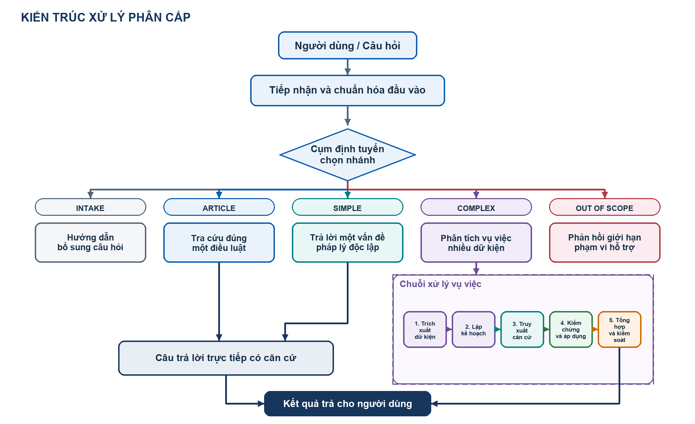

Mô hình ngôn ngữ hiểu nội dung câu hỏi, xác định vấn đề và đánh giá nguồn. Mã Python kiểm tra định dạng kết quả và các liên kết giữa dữ kiện, kế hoạch, căn cứ. Khi kế hoạch chưa bám câu hỏi hoặc nguồn chưa đủ, hệ thống có thể điều chỉnh kế hoạch hoặc tìm bổ sung.

| Thành phần | Nhiệm vụ |
| --- | --- |
| Tiếp nhận và chuẩn hóa | Chuẩn hóa câu hỏi và ngữ cảnh hội thoại |
| Bộ phân loại câu hỏi (Router) | Xác định loại câu hỏi và chọn cách xử lý |
| Bộ trích xuất dữ kiện (Fact Extractor) | Tách thông tin vụ việc và giữ đoạn nguyên văn tương ứng |
| Bộ lập và điều chỉnh kế hoạch (Planner) | Xác định vấn đề, thông tin cần tìm, thời điểm áp dụng và thứ tự giải quyết |
| Bộ tìm căn cứ (Retrieval) | Tìm nguồn theo từ khóa và ý nghĩa, xếp lại thứ tự và tìm thêm qua dẫn chiếu |
| Bộ kiểm chứng căn cứ (Evidence Verification) | Kiểm tra nguồn có hỗ trợ nhận định và điều kiện có phù hợp với dữ kiện hay không |
| Bộ soạn và kiểm tra câu trả lời | Viết từng phần trả lời, giữ/sửa/loại nội dung trước khi hiển thị |
| Bộ điều phối (Orchestrator) | Gọi các bước theo đúng thứ tự, theo dõi lỗi và quản lý việc sử dụng GPU |

### 1.2. Định tuyến và hai luồng trả lời trực tiếp

| Nhánh | Trường hợp sử dụng | Cách xử lý |
| --- | --- | --- |
| `INTAKE` | Chưa có yêu cầu pháp lý rõ | Hướng dẫn bổ sung câu hỏi |
| `ARTICLE` | Yêu cầu đọc hoặc giải thích đúng một điều luật | Lọc chính xác văn bản và vị trí pháp lý, lấy các đoạn thuộc điều rồi tóm tắt có trích dẫn |
| `SIMPLE` | Hỏi một quy định hoặc thủ tục chung | Tìm căn cứ, chọn nguồn và trả lời trực tiếp |
| `COMPLEX` | Kết luận phụ thuộc dữ kiện hoặc nhiều vấn đề liên quan | Chạy chuỗi trích xuất, lập kế hoạch, truy xuất, kiểm chứng và áp dụng |
| `OUT OF SCOPE` | Yêu cầu ngoài phạm vi hỗ trợ | Phản hồi giới hạn và hướng dẫn lại |

<details>
<summary>Xem cách phân loại câu hỏi và xử lý yêu cầu tra cứu trực tiếp</summary>

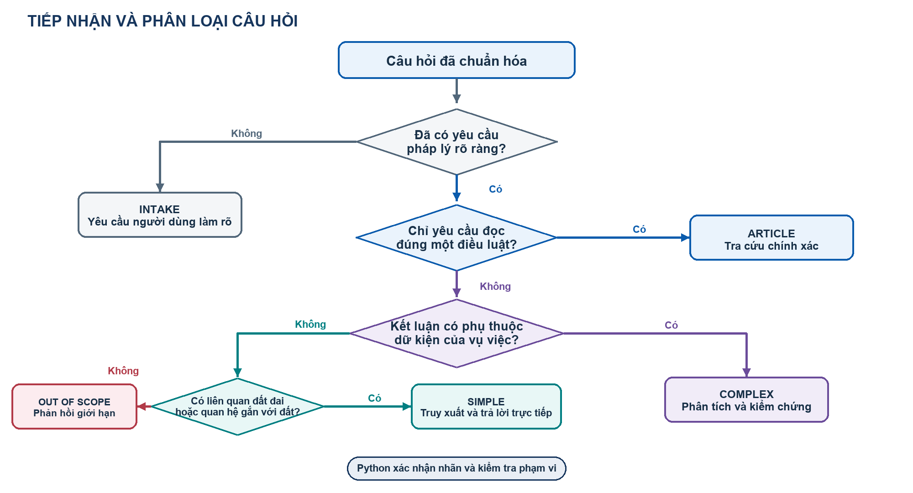

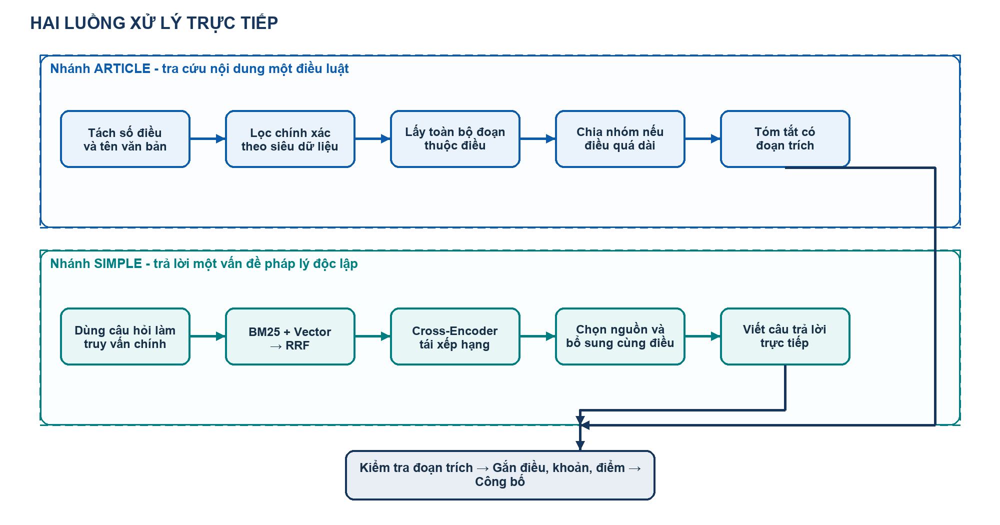

</details>

### 1.3. Xác định dữ kiện và lập kế hoạch tìm căn cứ

Fact Extractor tách các thông tin như chủ thể, hành vi, thời điểm và tình trạng giấy tờ từ câu hỏi. Mỗi dữ kiện giữ đoạn văn gốc để kiểm tra lại. Planner dùng câu hỏi, danh sách dữ kiện và mốc thời gian để xác định **vấn đề cần giải quyết** (`Issue`) và **thông tin cần tìm để giải quyết vấn đề đó** (`Requirement`). Mỗi yêu cầu tìm kiếm có mục tiêu, câu truy vấn và dữ kiện liên quan.

Trước khi tìm kiếm, chương trình kiểm tra kết quả có đúng định dạng JSON, đủ trường, dùng đúng mã dữ kiện (ID) và nằm trong giới hạn số vấn đề, số yêu cầu cho phép hay không. Kế hoạch được rà soát để tìm phần chưa bám câu hỏi. Bộ điều chỉnh chỉ cập nhật phần được đánh dấu; nếu kết quả mới không đạt kiểm tra, hệ thống giữ kế hoạch trước đó.

<details>
<summary>Xem cách rà soát và điều chỉnh kế hoạch</summary>

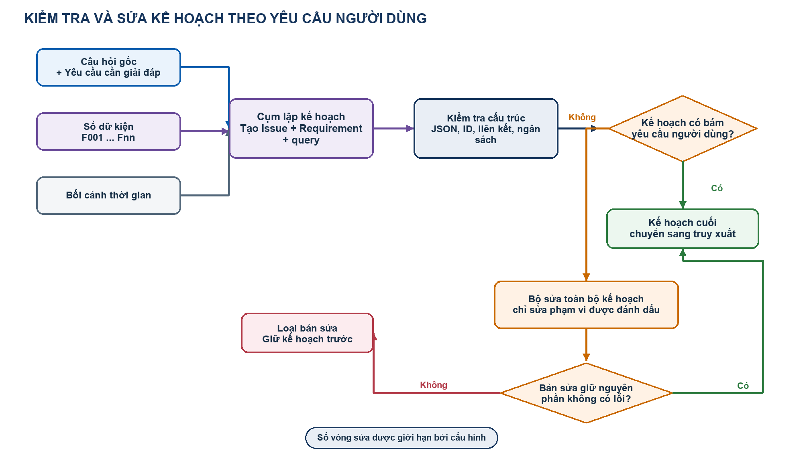

</details>

### 1.4. Truy xuất theo từng yêu cầu

Hệ thống tìm nguồn theo hai cách: **BM25** tìm các từ và cụm từ phù hợp; **BGE-M3** tìm các đoạn gần nghĩa với câu hỏi. **RRF** kết hợp hai danh sách kết quả. Sau đó, mô hình **reranker** đọc từng cặp câu hỏi–nguồn để đưa nguồn phù hợp hơn lên đầu. Khi câu hỏi nêu rõ văn bản, Điều, Khoản hoặc Điểm, hệ thống có thể lọc trực tiếp theo các thông tin này. Nếu nguồn dẫn đến quy định khác, hệ thống tìm thêm trong giới hạn đã đặt.

Mỗi nguồn ghi lại nó được tìm cho yêu cầu nào và đến từ văn bản nào. Khi đánh giá một yêu cầu, hệ thống kiểm tra nguồn theo đúng nội dung cần giải đáp của yêu cầu đó.

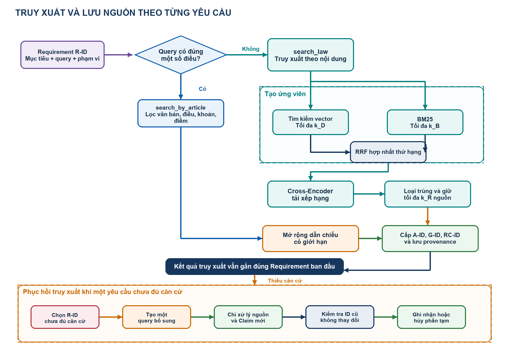

### 1.5. Kiểm chứng và đối chiếu điều kiện áp dụng

Mỗi nhận định pháp lý được kiểm tra bằng hai câu hỏi: **nguồn có hỗ trợ nội dung nhận định hay không** và **nhận định có giải đáp yêu cầu đang xét hay không**. Với nhận định được chấp nhận, hệ thống tách các điều kiện cần đáp ứng đồng thời (`ALL`), các lựa chọn chỉ cần đáp ứng một (`ANY`) và các ngoại lệ (`EXCEPTION`). Từng điều kiện được đối chiếu với dữ kiện để xác định đã đáp ứng (`SATISFIED`), có thông tin trái với điều kiện (`CONTRADICTED`) hoặc chưa đủ thông tin (`UNKNOWN`).

Kết quả cho biết căn cứ đủ điều kiện áp dụng (`APPLIES`), còn thiếu dữ kiện (`INSUFFICIENT_FACTS`), chưa đáp ứng điều kiện (`CONDITION_NOT_MET`), nằm ngoài phạm vi áp dụng (`DOES_NOT_APPLY`) hoặc có ngoại lệ được xác nhận (`EXCEPTION_APPLIES`). Thông tin chưa được cung cấp được giữ ở trạng thái chưa xác định.

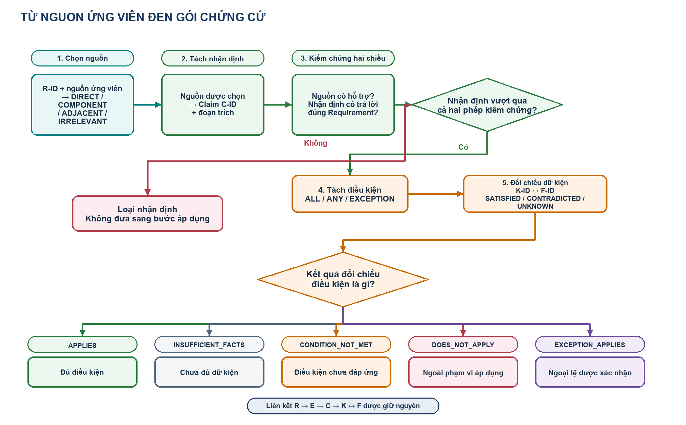

### 1.6. Kiểm soát câu trả lời và tài nguyên

Bộ soạn viết từng phần trả lời kèm nguồn, nhận định và dữ kiện đã dùng. Bộ kiểm soát quyết định giữ nguyên (`KEEP`), chỉnh cách diễn đạt (`REVISE`) hoặc loại phần chưa đạt (`DROP`). Trước khi hiển thị, chương trình kiểm tra lại nội dung, trích dẫn và điều kiện áp dụng. Người đọc có thể đối chiếu kết luận với những căn cứ được ghi trong câu trả lời.

Để hạn chế lượng bộ nhớ GPU sử dụng, llama-server chỉ nạp một mô hình sinh câu trả lời tại một thời điểm. Mô hình tạo vector tìm kiếm (embedding) và mô hình xếp lại nguồn (reranker) lần lượt sử dụng GPU. Khi reranker thiếu bộ nhớ, hệ thống thử chạy trên CPU; nếu vẫn không thành công thì dùng thứ tự nguồn đã có từ RRF.

<details>
<summary>Xem cách kiểm tra câu trả lời và quản lý tài nguyên mô hình</summary>

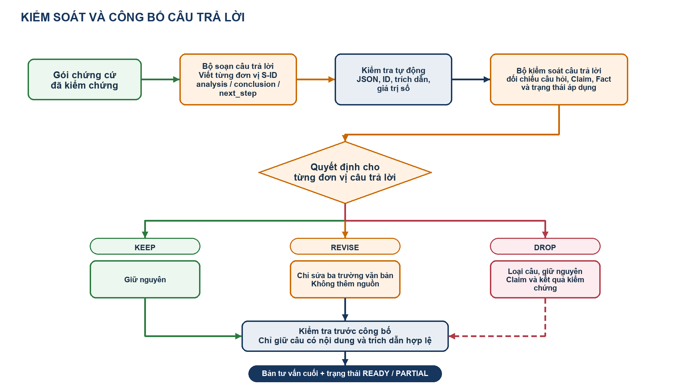

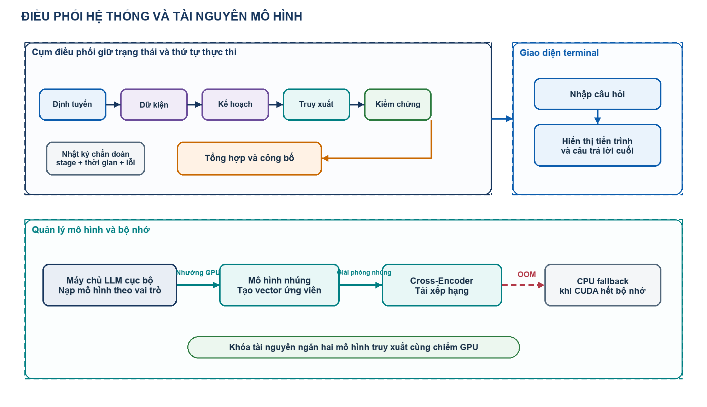

</details>

---

## 2. Yêu cầu cài đặt

### 2.1. Phần mềm

- Windows 10 hoặc Windows 11 phiên bản 64 bit.
- Python 3.12.
- Trình điều khiển NVIDIA tương thích với GPU đang sử dụng.
- PowerShell có sẵn trên Windows.

### 2.2. Phần cứng

- GPU NVIDIA có tối thiểu 8 GB VRAM.
- RAM tối thiểu 16 GB; khuyến nghị 32 GB.
- Nên dành ít nhất 30 GB ổ trống để tải và giải nén tài nguyên; môi trường Python và cache có thể cần thêm dung lượng.

Cấu hình trên là mức tham khảo từ bản demo. Khả năng chạy còn phụ thuộc độ dài ngữ cảnh, bộ llama.cpp và mức sử dụng GPU. Bản GitHub không kèm trọng số AI, bộ chạy hay kho vector; cần tải riêng trước khi khởi động.

---

## 3. Cài đặt tài nguyên và thư viện Python

### 3.1. Tải mã nguồn và tài nguyên AI

Trên GitHub, chọn **Code → Download ZIP** rồi giải nén, hoặc clone repository bằng Git. Mở PowerShell tại thư mục chứa `main.py`.

Tải các gói được liệt kê trong [docs/AI_ASSETS.md](docs/AI_ASSETS.md) và giải nén vào đúng vị trí: `vendor/local-ai/`, `vendor/huggingface/models/`, `models/adapters/` và `data/retrieval_store/`. Clone mã nguồn chưa đủ để chạy bản demo cục bộ.

**Model nền** là mô hình ngôn ngữ gốc. **Adapter** là bộ trọng số bổ sung được huấn luyện để model nền làm tốt một nhiệm vụ cụ thể, như tách dữ kiện hoặc lập kế hoạch. Dự án cần cả model nền và adapter phù hợp.

Trước khi dùng lệnh tải, tạo môi trường Python theo mục 3.2 nếu máy chưa có môi trường phù hợp. Sau đó cài công cụ Hugging Face và tải adapter cùng kho truy xuất tại thư mục gốc dự án:

```powershell
python -m pip install -U huggingface_hub
hf download vikhanglam625/vn-land-counsel-adapters --local-dir "models/adapters"
hf download vikhanglam625/dataset-luat-dat-dai-tranh-chap --repo-type dataset --local-dir "data/retrieval_store"
```

Không cần được cấp quyền riêng để tải hai kho Public. Đăng nhập Hugging Face có thể hữu ích nếu gặp giới hạn tải của dịch vụ.

Launcher hiện kiểm tra đủ **hai model nền và bảy adapter**, kể cả những cấu hình so sánh không được chọn trong luồng mặc định. Hãy tải đủ bộ tài nguyên theo hướng dẫn, giữ nguyên tên file và cấu trúc thư mục.

### 3.2. Cài thư viện

Mở PowerShell tại thư mục gốc của dự án và thực hiện lần lượt:

```powershell
py -3.12 -m venv .venv
Set-ExecutionPolicy -Scope Process Bypass
.\.venv\Scripts\Activate.ps1
python -m pip install --upgrade pip
python -m pip install -r requirements.txt
```

Sau khi cài đặt hoàn tất, có thể đóng PowerShell. Những lần chạy sau không cần cài lại thư viện.

Nếu máy đã có sẵn môi trường Python 3.12 với đầy đủ thư viện trong `requirements.txt`, có thể bỏ qua bước tạo môi trường ảo.

Máy cần kết nối mạng để tải thư viện và tài nguyên ban đầu. Sau khi chuẩn bị đầy đủ tài nguyên cục bộ, bản demo suy luận không yêu cầu khóa API.

---

## 4. Khởi động hệ thống

### 4.1. Cách khởi động thông thường

Nhấp đúp vào tệp:

```text
KHOI_DONG_HE_THONG.bat
```

Chương trình sẽ kiểm tra tài nguyên, khởi động máy chủ mô hình tại cổng `8080` và mở giao diện hỏi đáp. Quá trình nạp mô hình ở lần đầu có thể mất một vài phút.

Khi terminal xuất hiện dòng sau, hệ thống đã sẵn sàng:

```text
Bạn:
```

Launcher tự tạo lại `runtime/llama-models.ini` theo vị trí thư mục hiện tại. File này chứa đường dẫn tuyệt đối của máy và được bỏ qua bởi Git; không cần sao chép preset từ máy tác giả.

### 4.2. Khởi động bằng PowerShell

Nếu Windows không cho phép chạy trực tiếp tệp PowerShell, mở PowerShell tại thư mục dự án và dùng lệnh:

```powershell
powershell.exe -NoLogo -NoProfile -ExecutionPolicy Bypass `
    -File ".\scripts\run_local.ps1" `
    -ModelProfile answer_8b `
    -PlannerVariant lora_8b_sft_3000 `
    -AppMode terminal `
    -Port 8080 `
    -ContextSize 20000
```

### 4.3. Chế độ kiểm tra

- `KHOI_DONG_DEBUG.bat`: hiển thị dữ liệu chẩn đoán của từng giai đoạn.
- `KHOI_DONG_LLM_SERVER.bat`: chỉ khởi động máy chủ mô hình tại cổng `8080`.

Chế độ debug chỉ nên dùng khi cần xác định lỗi. Khi trình diễn hoặc sử dụng bình thường, dùng `KHOI_DONG_HE_THONG.bat`.

---

## 5. Hướng dẫn sử dụng

### Giao diện và kết quả minh họa

Giao diện hiển thị cấu hình đang chạy và nhận câu hỏi tại dòng `Bạn:`. Ví dụ dưới đây là một lượt hỏi về quy trình cấp sổ đỏ lần đầu; câu trả lời có phần hướng dẫn và danh sách căn cứ đã dùng.

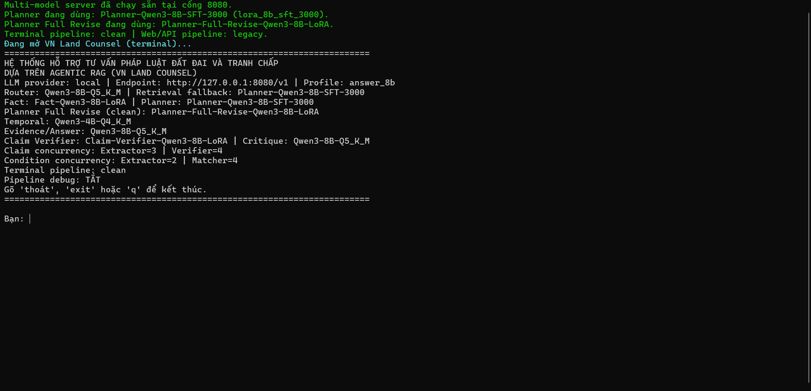

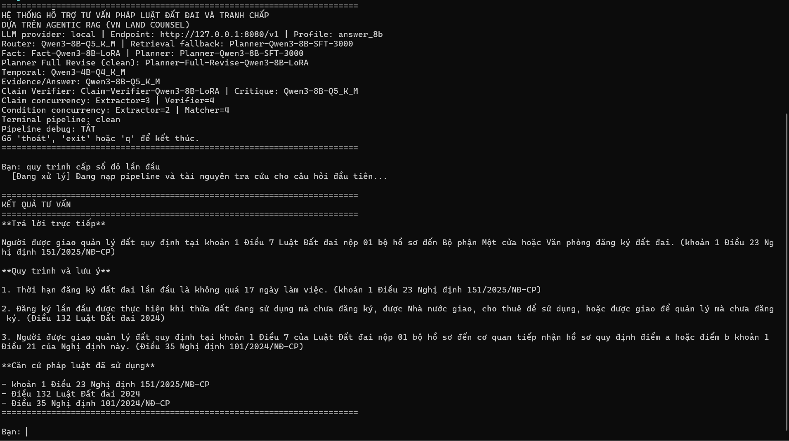

### Đặt câu hỏi

Nhập câu hỏi bằng tiếng Việt tại dòng `Bạn:` rồi nhấn `Enter`.

Ví dụ câu hỏi tra cứu thủ tục:

```text
Quy trình cấp sổ đỏ lần đầu được thực hiện như thế nào?
```

Ví dụ câu hỏi tình huống:

```text
Năm 2025, hai bên ký hợp đồng chuyển nhượng đất có công chứng.
Bên mua đã trả đủ tiền nhưng chưa đăng ký sang tên. Sau đó bên bán
không giao đất và muốn hủy giao dịch. Bên mua cần làm gì?
```

Tùy theo nội dung câu hỏi, kết quả có thể gồm:

- Câu trả lời trực tiếp hoặc nhận định chính.
- Phân tích tình huống.
- Quy trình hoặc hướng xử lý đề xuất.
- Căn cứ pháp luật đã sử dụng.
- Thông tin còn thiếu và nội dung cần đối chiếu thêm.

Câu hỏi về một quy định hoặc thủ tục thường được xử lý nhanh hơn. Tình huống có nhiều dữ kiện cần thêm thời gian để lập kế hoạch, truy xuất và kiểm chứng căn cứ.

<details>
<summary>Xem ví dụ phân tích một tình huống qua toàn bộ quy trình</summary>

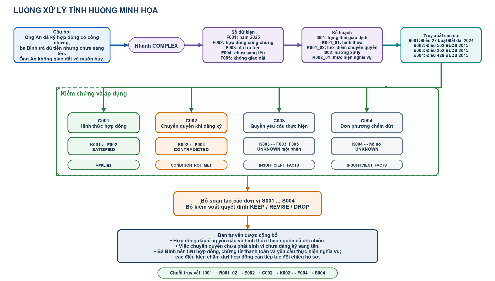

</details>

Nhập một trong các lệnh sau để kết thúc:

```text
thoát
exit
q
```

---

## 6. Cấu trúc thư mục

| Đường dẫn | Nội dung |
|---|---|
| `main.py` | Điểm khởi chạy chương trình |
| `core/` | Xử lý câu hỏi, mô hình ngôn ngữ và giao diện terminal |
| `core/pipeline/` | Các thành phần của quy trình Agentic RAG |
| `retrieval/` | Tìm kiếm từ khóa, tìm kiếm vector và tái xếp hạng |
| `dataset/` | Dữ liệu văn bản pháp luật gốc |
| `data/retrieval_store/` | Các đoạn văn bản pháp luật đã chia nhỏ và cơ sở dữ liệu tìm kiếm ChromaDB |
| `models/adapters/` | Các adapter do nhóm huấn luyện |
| `training_data/` | Dữ liệu SFT và DPO được sử dụng trong đề tài |
| `vendor/` | Máy chủ `llama.cpp` và các mô hình cục bộ |
| `runtime/` | Tệp cấu hình mô hình |
| `scripts/` | Tập lệnh khởi động hệ thống |
| `docs/` | Hướng dẫn tải tài nguyên AI và công bố repository |
| `docs/images/` | Sơ đồ kiến trúc, quy trình xử lý và ảnh demo |

Các thư mục tài nguyên AI trong bảng là cấu trúc sau khi cài đặt; trọng số trong `models/`, toàn bộ `vendor/` và kho truy xuất ngoài README được tải riêng. `.gitignore` vẫn giữ mô tả và cấu hình adapter trong Git.

---

## 7. Công nghệ sử dụng

- Mô hình ngôn ngữ: Qwen3-8B.
- Tinh chỉnh mô hình: LoRA và QLoRA.
- Mô hình nhúng: BGE-M3.
- Tái xếp hạng: BGE-Reranker-v2-M3.
- Cơ sở dữ liệu vector: ChromaDB.
- Truy xuất: BM25, tìm kiếm vector, Reciprocal Rank Fusion và Cross-Encoder.
- Máy chủ suy luận: llama.cpp.
- Ngôn ngữ phát triển: Python.
- Giao diện sử dụng: Windows Terminal.

---

## 8. Dữ liệu và cấu hình thực nghiệm

### 8.1. Kho dữ liệu pháp luật

Văn bản được chia thành các đoạn nhỏ để tìm kiếm, gọi là **chunk**, theo cấu trúc Điều → Khoản → Điểm. Một Điều không quá 500 từ được giữ nguyên; nội dung dài được tách theo cấu trúc, với ngưỡng an toàn 800 từ và các phần khoảng 600 từ khi cần. Mỗi đoạn chỉ chứa nội dung thuộc cùng một Điều.

Mỗi chunk pháp luật có 23 trường thông tin đi kèm (**metadata**), như tên văn bản, vị trí Điều/Khoản/Điểm, thời gian hiệu lực và quan hệ sửa đổi/thay thế. Kho pháp luật trước lọc có 10.125 chunk từ 40 văn bản; khi bổ sung bản án và án lệ, tổng kho trước lọc là 14.169 chunk.

**Số đoạn dữ liệu trước và sau khi lọc để đưa vào kho tìm kiếm:**

| Loại nguồn | Chunk trước lọc | Bản ghi trong ChromaDB |
| --- | ---: | ---: |
| Luật và bộ luật | 6.018 | 5.778 |
| Nghị định | 3.605 | 3.382 |
| Thông tư | 282 | 282 |
| Nghị quyết | 220 | 211 |
| Bản án | 3.628 | 3.628 |
| Án lệ | 416 | 416 |
| **Tổng cộng** | **14.169** | **13.697** |

### 8.2. Dữ liệu huấn luyện và kiểm thử

Tập **Train** dùng để huấn luyện. Tập **Validation** dùng để theo dõi chất lượng và chọn phiên bản mô hình trong quá trình phát triển. Tập **Test** dùng để đánh giá sau khi chốt cấu hình; “kiểm thử ẩn” là phần được giữ lại cho bước này.

| Thành phần | Tổng số | Train | Validation | Test | Tập dùng báo cáo kết quả |
| --- | ---: | ---: | ---: | ---: | --- |
| Trích xuất dữ kiện | 2.000 | 1.600 | 200 | 200 | 200 mẫu validation |
| Lập kế hoạch ban đầu | 3.000 | 2.400 | 300 | 300 | 300 mẫu kiểm thử ẩn |
| Điều chỉnh kế hoạch truy xuất | 2.200 | 1.760 | 220 | 220 | 220 mẫu kiểm thử ẩn |
| Kiểm chứng nhận định | 3.000 | 2.386 | 307 | 307 | 307 mẫu kiểm thử ẩn |

`training_data/` có dữ liệu cho **SFT** (huấn luyện từ các cặp đầu vào và câu trả lời mẫu) và **DPO** (huấn luyện theo cặp câu trả lời được ưu tiên và không được ưu tiên). Các bảng kết quả ở mục 9 đánh giá mô hình sau SFT; chưa có phép so sánh hiệu quả DPO trong các bảng này.

### 8.3. Tham số QLoRA

**QLoRA** giảm bộ nhớ huấn luyện bằng cách nén trọng số model nền và chỉ học bộ trọng số bổ sung LoRA. Các adapter 8B trong cấu hình thực nghiệm chính được tinh chỉnh từ Qwen3-8B; trọng số model nền được giữ cố định.

**Tham số huấn luyện chung:**

| Tham số | Giá trị |
| --- | --- |
| Model nền | Qwen3-8B |
| Lượng tử hóa khi huấn luyện | 4 bit NF4, lượng tử hóa kép |
| LoRA | Rank `16`, alpha `32` |
| Lớp được tinh chỉnh | `q_proj`, `k_proj`, `v_proj`, `o_proj`, `gate_proj`, `up_proj`, `down_proj` |
| Phần được tính lỗi huấn luyện (loss) | Chỉ tính trên phần trả lời (completion) |
| Số mẫu mỗi lượt tính và tích lũy cập nhật | Batch 1–2; tích lũy 8–16; batch hiệu dụng 16 |
| Giá trị khởi tạo ngẫu nhiên (seed) | `42` |
| Chế độ sinh phần suy nghĩ (thinking mode) | Tắt |

**Cấu hình theo nhiệm vụ:**

`Epoch` là một lượt đi qua tập huấn luyện. `Learning rate` là mức cập nhật trọng số. `Checkpoint` là phiên bản mô hình được lưu trong quá trình học; cột cuối cho biết phiên bản được chọn để sử dụng.

| Nhiệm vụ | Epoch cấu hình | Độ dài tối đa (token) | Learning rate | Checkpoint được chọn |
| --- | ---: | ---: | --- | --- |
| Trích xuất dữ kiện | 3 | 1.536 | `2e-4` | Bước 200, epoch 2 |
| Lập kế hoạch ban đầu | 3 | 6.144 | `1e-4` | Theo validation loss |
| Điều chỉnh kế hoạch truy xuất | 3 | 6.144 | `1e-4` | Bước 220, epoch 2 |
| Kiểm chứng nhận định | 3 | 1.536 | `1e-4` | Bước 300 |

Fact Extractor được huấn luyện trên Kaggle Tesla T4 với FP16. Planner, bộ sửa kế hoạch và Claim Verifier được huấn luyện trên RTX 5090 thuê qua Vast.ai với BF16, điều khiển từ Colab. Các môi trường này phục vụ huấn luyện; bản demo suy luận chạy trên máy cá nhân.

### 8.4. Cấu hình suy luận cục bộ

**Môi trường chạy thực nghiệm:**

| Thành phần | Cấu hình thực nghiệm |
| --- | --- |
| Hệ điều hành, môi trường | Windows 11, Python 3.12 |
| GPU | NVIDIA GeForce RTX 5070 Laptop, 8.151 MiB VRAM |
| Máy chủ suy luận | llama.cpp build `10021`, commit `33a75f41c` |
| Model nền | Qwen3-4B `Q4_K_M`; Qwen3-8B `Q5_K_M` |
| Adapter suy luận | GGUF F16, nạp cùng model nền tương ứng |
| Context và bộ nhớ đệm | 20.000 token; KV cache `Q8_0`; Flash Attention bật |
| Batch / ubatch | `256` / `128` |
| Điều phối model sinh | Một model trong bộ nhớ tại một thời điểm; giải phóng sau 60 giây không hoạt động |
| Embedding / reranker | BGE-M3 / BGE-Reranker-v2-M3 |

**Giới hạn số bước và số nguồn khi xử lý câu hỏi:**

| Tham số | Giá trị tham chiếu |
| --- | ---: |
| Số vấn đề pháp lý tối đa trong kế hoạch | 3 |
| Yêu cầu tìm kiếm tối đa trên một vấn đề | 2 |
| Dữ kiện liên kết tối đa trên một yêu cầu | 6 |
| Ứng viên vector / BM25 | 20 / 20 |
| Tham số RRF | 60 |
| Nguồn sau cross-encoder | 5 |
| Độ dài đầu vào cross-encoder | 1.024 token |
| Truy vấn tối đa trên một yêu cầu | 2 |
| Điều mở rộng qua dẫn chiếu / độ sâu | 2 / 1 |
| Nguồn được bộ lựa chọn giữ lại | 4 |
| Nhận định tối đa từ một nguồn | 3 |
| Vòng sửa kế hoạch sau đánh giá | 1 |
| Độ dài sinh tối đa cho một phần trả lời | 800 token |

Các giới hạn này giúp kiểm soát số lần gọi mô hình, thời gian chờ và lượng bộ nhớ sử dụng. Khi thay đổi chúng, cần đánh giá lại chất lượng và thời gian xử lý.

## 9. Kết quả đánh giá

### 9.1. Thiết kế đánh giá E1–E5

Các phép so sánh trong cùng một thí nghiệm dùng chung dữ liệu, chỉ dẫn cho mô hình (prompt), định dạng đầu ra, tham số sinh và cách chấm. Đầu ra sai JSON, thiếu trường, liên kết sai dữ kiện hoặc lượt xử lý bị dừng vẫn được ghi nhận trong thống kê tương ứng.

**Mỗi nhóm đánh giá một phần của hệ thống:**

| Nhóm | Số mẫu | Nội dung |
| --- | --- | --- |
| E1 | 200 validation | Trích xuất dữ kiện |
| E2 — Lập kế hoạch | 300 kiểm thử ẩn | So sánh khả năng lập kế hoạch ban đầu của Base và SFT |
| E2 — Điều chỉnh kế hoạch | 220 kiểm thử ẩn | Đo mức cải thiện của kế hoạch sau khi rà soát và điều chỉnh |
| E3 | 307 kiểm thử ẩn | Kiểm chứng nhận định theo hai chiều |
| E4 — cốt lõi | 25 câu đã duyệt | 21 câu hiện hành, 4 câu lịch sử; 14 dạng truy vấn |
| E4 — thuật ngữ | 50 cặp, 100 truy vấn | Câu đời thường và câu pháp lý cùng trỏ đến một căn cứ |
| E5 | 100 câu | 45 dễ, 27 trung bình, 28 khó; lấy cố định 100 câu đầu của benchmark 460 câu |

E5 không được dùng để huấn luyện các mô hình thành phần. E1 được đo trên validation, tức tập đã dùng trong quá trình phát triển. E2 và E3 dùng các tập kiểm thử ẩn như trong bảng. Kết quả từng bước giúp xác định khả năng của thành phần đó; E5 mới đo kết quả khi ghép các bước để trả lời câu hỏi.

**Cách đọc các chỉ số:**

| Thuật ngữ | Ý nghĩa |
| --- | --- |
| Base / SFT | Model nền / model đã được huấn luyện thêm cho nhiệm vụ |
| JSON hợp lệ | Kết quả có thể được chương trình đọc như dữ liệu JSON |
| Lược đồ hoặc hợp đồng dữ liệu hợp lệ | Đủ trường, đúng kiểu dữ liệu, đúng nhãn cho phép và đúng liên kết ID theo yêu cầu của bước xử lý |
| Exact Match | Toàn bộ bản ghi khớp đáp án tham chiếu sau chuẩn hóa |
| Precision | Trong các mục mô hình đưa ra, có bao nhiêu mục đúng |
| Recall | Trong các mục cần tìm theo đáp án, mô hình tìm được bao nhiêu |
| F1 | Điểm tổng hợp cân bằng Precision và Recall |
| Hit@K | Tỷ lệ truy vấn có ít nhất một nguồn đúng trong K kết quả đầu |
| MRR@20 | Điểm đánh giá vị trí nguồn đúng đầu tiên trong danh sách; nguồn đúng xuất hiện càng sớm thì điểm càng cao |
| nDCG@10 | Điểm đánh giá cách sắp xếp các nguồn trong danh sách; ưu tiên đưa nguồn liên quan hơn lên đầu |

Với các chỉ số chất lượng trong bảng, điểm cao hơn thường tốt hơn. Riêng tỷ lệ chấp nhận sai và loại nhầm có dấu `↓`: điểm thấp hơn tốt hơn.

### 9.2. E1 — Trích xuất dữ kiện

Phép thử yêu cầu mô hình tách dữ kiện từ câu hỏi và giữ đoạn văn làm căn cứ cho mỗi dữ kiện. Kết quả được đo trên **200 mẫu validation**:

| Chỉ số | Qwen3-8B Base | Qwen3-8B SFT |
| --- | ---: | ---: |
| JSON hợp lệ | 100,00% | 100,00% |
| Lược đồ hợp lệ | 81,50% | 99,50% |
| Khớp chính xác toàn bản ghi | 3,00% | 23,50% |
| Precision dữ kiện | 34,67% | 66,89% |
| Recall dữ kiện | 46,86% | 65,43% |
| F1 dữ kiện | 39,85% | 66,15% |
| Dữ kiện khớp đoạn nguồn | 97,60% | 100,00% |

SFT giúp kết quả đúng định dạng hơn và trích đúng đoạn văn gốc. Tuy vậy, tỷ lệ khớp toàn bộ bản ghi 23,50% cho thấy mô hình vẫn có thể bỏ sót dữ kiện hoặc tách phạm vi dữ kiện khác với đáp án tham chiếu. Trích đúng nguyên văn chưa có nghĩa đã nhận diện đủ mọi dữ kiện.

### 9.3. E2 — Chất lượng kế hoạch truy xuất ban đầu

Kế hoạch truy xuất xác định những vấn đề pháp lý cần giải quyết, thông tin cần tìm, câu truy vấn và dữ kiện liên quan. Phép thử này so sánh khả năng tạo kế hoạch của mô hình nền (Base) với mô hình đã tinh chỉnh (SFT) trên cùng 300 câu hỏi kiểm thử.

**Kết quả trên 300 mẫu kiểm thử ẩn:**

| Chỉ số | Qwen3-8B Base | Qwen3-8B SFT |
| --- | ---: | ---: |
| JSON hợp lệ | 99,67% | 100,00% |
| Hợp đồng dữ liệu hợp lệ | 92,33% | 100,00% |
| Số vấn đề chính xác | 54,33% | 74,33% |
| Số yêu cầu chính xác | 27,00% | 70,00% |
| Loại vấn đề chính xác | 4,42% | 60,56% |
| Mốc thời gian chính xác | 27,62% | 77,00% |
| Quan hệ phụ thuộc chính xác | 60,97% | 87,25% |
| Loại thông tin cần tìm chính xác | 8,32% | 48,16% |
| Precision Fact ID | 54,58% | 81,49% |
| Recall Fact ID | 43,46% | 84,51% |
| F1 Fact ID | 44,95% | 81,74% |
| F1 mục tiêu truy xuất | 16,09% | 32,59% |
| F1 truy vấn | 20,92% | 49,08% |

### 9.4. E2 — Cải thiện kế hoạch sau rà soát

Sau khi có kế hoạch ban đầu, hệ thống rà soát xem kế hoạch đã bám câu hỏi, xác định đủ vấn đề và tạo truy vấn phù hợp hay chưa. Bộ điều chỉnh nhận kế hoạch cùng chỉ dẫn về phần cần sửa, cập nhật phần đó và giữ các phần đã đúng. Bảng dưới đo chất lượng kế hoạch **trước và sau bước điều chỉnh** trên cùng 220 mẫu kiểm thử.

Hai phần của E2 đánh giá hai việc khác nhau: mục 9.3 so sánh **Base với SFT khi lập kế hoạch ban đầu**; mục 9.4 so sánh **một kế hoạch trước và sau điều chỉnh**. Chúng dùng hai tập kiểm thử riêng, nên không đọc các cột của hai bảng như một chuỗi kết quả trên cùng bộ câu hỏi.

**Kết quả trên 220 mẫu kiểm thử ẩn; trước và sau điều chỉnh được chấm theo cùng đáp án:**

| Chỉ số | Kế hoạch ban đầu | Sau rà soát và điều chỉnh |
| --- | ---: | ---: |
| Số vấn đề chính xác | 80,45% | 95,00% |
| Số yêu cầu chính xác | 93,64% | 96,36% |
| Loại vấn đề chính xác | 89,24% | 93,71% |
| Mốc thời gian chính xác | 85,91% | 93,86% |
| Quan hệ phụ thuộc chính xác | 89,24% | 95,53% |
| Loại thông tin cần tìm chính xác | 75,83% | 86,21% |
| F1 Fact ID | 88,92% | 95,40% |
| F1 mục tiêu truy xuất | 84,52% | 89,45% |
| F1 truy vấn | 70,65% | 86,69% |
| Khớp chính xác toàn cấu trúc | 0,00% | 25,00% |

Có 6/220 kế hoạch sau điều chỉnh không đạt yêu cầu về định dạng hoặc liên kết dữ liệu. Hệ thống chỉ dùng kế hoạch điều chỉnh sau khi nó vượt qua bước kiểm tra này.

### 9.5. E3 — Kiểm chứng nhận định

Mô hình nhận một yêu cầu tìm kiếm, một nhận định và đoạn nguồn. Nó cần xác định nguồn có hỗ trợ nhận định và nhận định liên quan đến yêu cầu ở mức nào. `DIRECT` là nội dung trực tiếp giải đáp yêu cầu; `COMPONENT SUPPORT` là nội dung hỗ trợ một phần.

**Kết quả trên 307 mẫu kiểm thử ẩn:**

| Chỉ số | Qwen3-8B Base | Qwen3-8B SFT |
| --- | ---: | ---: |
| JSON hợp lệ | 100,00% | 100,00% |
| Hợp đồng dữ liệu hợp lệ | 100,00% | 100,00% |
| Đúng quan hệ suy diễn | 75,57% | 98,37% |
| Đúng mức liên quan | 43,00% | 82,08% |
| Đúng đồng thời hai nhãn | 36,16% | 80,46% |
| F1 nhãn DIRECT | 64,81% | 90,03% |
| F1 nhãn COMPONENT SUPPORT | 0,00% | 61,54% |
| Macro F1 mức liên quan | 27,19% | 77,51% |
| Tỷ lệ chấp nhận sai ↓ | 20,00% | 12,67% |
| Tỷ lệ loại nhầm ↓ | 29,94% | 3,82% |

“Đúng đồng thời hai nhãn” yêu cầu cả quyết định về sự hỗ trợ của nguồn và quyết định về mức liên quan đều đúng. “Chấp nhận sai” là giữ nhận định đáng lẽ phải loại; “loại nhầm” là bỏ nhận định đáng lẽ cần giữ. Tỷ lệ chấp nhận sai còn 12,67% cho thấy hệ thống vẫn cần bước đối chiếu điều kiện với dữ kiện trước khi kết luận cho vụ việc.

### 9.6. E4 — Truy xuất căn cứ

Phép thử này chỉ đánh giá việc tìm và xếp thứ tự nguồn, chưa đánh giá câu trả lời được viết từ các nguồn đó.

**Tập 25 câu đã có đáp án đối chiếu; các phương pháp dùng cùng kho và câu truy vấn:**

| Phương pháp | Hit@1 | Hit@5 | Hit@10 | MRR@20 | nDCG@10 |
| --- | ---: | ---: | ---: | ---: | ---: |
| BM25 | 68,00% | 92,00% | 96,00% | 78,45% | 83,89% |
| Vector | 68,00% | 88,00% | 92,00% | 76,36% | 79,92% |
| Kết hợp | 68,00% | 96,00% | 100,00% | 79,67% | 84,72% |
| Kết hợp + tái xếp hạng | **84,00%** | **100,00%** | **100,00%** | **89,80%** | **93,47%** |

**Tập 50 cặp câu cùng hỏi về một căn cứ, tổng cộng 100 truy vấn:** Mỗi cặp gồm một câu dùng cách nói đời thường và một câu dùng thuật ngữ pháp lý. Hai cột cuối cho thấy ảnh hưởng của cách diễn đạt đến việc tìm đúng nguồn ở vị trí đầu.

| Phương pháp | Hit@1 | Hit@5 | Hit@10 | MRR@20 | Hit@1 đời thường | Hit@1 pháp lý |
| --- | ---: | ---: | ---: | ---: | ---: | ---: |
| BM25 | 49,00% | 70,00% | 75,00% | 58,68% | 30,00% | 68,00% |
| Vector | 52,00% | 74,00% | 78,00% | 61,83% | 40,00% | 64,00% |
| Kết hợp | 57,00% | 78,00% | 84,00% | 66,40% | 46,00% | 68,00% |
| Kết hợp + tái xếp hạng | **71,00%** | **87,00%** | **88,00%** | **78,25%** | **66,00%** | **76,00%** |

Hit@K đo có ít nhất một nguồn đúng trong K kết quả đầu, không đồng nghĩa tìm đủ mọi căn cứ cho một vụ việc. Hai tập E4 phục vụ mục tiêu khác nhau và được báo cáo riêng.

### 9.7. E5 — Chất lượng toàn hệ thống

Hệ thống hoàn tất **97/100 câu (97,00%)**. Ba câu khó dừng ở bước xử lý kế hoạch vì liên kết dữ kiện không đạt kiểm tra. Cột đầu chấm chất lượng trên những câu đã trả lời được. Cột sau tính trên cả tập, với các câu lỗi nhận điểm không, để thể hiện thêm ảnh hưởng của lỗi xử lý.

**Kết quả chung; các điểm trong khoảng 0–1:**

| Chỉ số | 97 câu có câu trả lời | Toàn bộ 100 câu, lỗi tính 0 |
| --- | ---: | ---: |
| Faithfulness | 0,8125 | 0,7882 |
| Answer Relevancy | 0,4955 | 0,4806 |
| Context Precision | 0,6726 | 0,6524 |
| Context Recall | 0,5999 | 0,5819 |
| Relevancy Cosine | 0,7636 | 0,7407 |

**Kết quả theo độ khó:** Cột “Hoàn tất” ghi số câu trả lời được trên tổng số câu của nhóm. Các điểm chất lượng chỉ tính trên những câu đã trả lời được trong nhóm đó.

| Độ khó | Hoàn tất | Faithfulness | Answer Relevancy | Relevancy Cosine | Context Precision | Context Recall |
| --- | ---: | ---: | ---: | ---: | ---: | ---: |
| Dễ | 45/45 | 0,8965 | 0,7710 | 0,8530 | 0,7258 | 0,7670 |
| Trung bình | 27/27 | 0,7187 | 0,2195 | 0,7081 | 0,6444 | 0,5834 |
| Khó | 25/28 | 0,7628 | 0,2977 | 0,6627 | 0,6072 | 0,3172 |

**Faithfulness** đo mức độ câu trả lời được hỗ trợ bởi nguồn đã tìm; **Answer Relevancy** đo mức trả lời đúng điều người dùng hỏi. **Context Precision** đánh giá nguồn đưa vào có tập trung vào nội dung cần thiết hay không; **Context Recall** đánh giá nguồn có bao phủ thông tin cần để trả lời theo đáp án tham chiếu hay không.

**Relevancy Cosine** đo mức gần nghĩa giữa câu hỏi gốc và các câu hỏi được tái tạo từ câu trả lời. Answer Relevancy còn xét việc câu trả lời có bị đánh giá là né tránh hay không, nên hai chỉ số có thể khác nhau đáng kể.

Các chỉ số Ragas giúp đánh giá mức bám câu hỏi và nguồn; để xác nhận đúng pháp luật vẫn cần đối chiếu đến Điều, Khoản, Điểm. E5 chỉ gồm 100 câu được chọn như mô tả, không đại diện cho toàn bộ benchmark 460 câu. Không có số liệu tốc độ chung cho E5 vì các lượt chạy sử dụng nhiều cấu hình phần cứng.

## 10. Xử lý sự cố thường gặp

### Không tìm thấy Python 3.12

Cài Python 3.12 từ trang chính thức của Python và chọn tùy chọn thêm Python vào `PATH`. Sau đó mở PowerShell mới và kiểm tra:

```powershell
py -3.12 --version
```

### Không chạy được tập lệnh PowerShell

Dùng lệnh ở mục 4.2. Tham số `-ExecutionPolicy Bypass` chỉ áp dụng cho tiến trình khởi động hiện tại và không thay đổi chính sách toàn hệ thống.

### Cổng 8080 đã được sử dụng

Đóng tiến trình đang chiếm cổng `8080` rồi chạy lại. Nếu một máy chủ của dự án đã hoạt động đúng cấu hình, chương trình có thể sử dụng lại máy chủ đó.

### Không tìm thấy mô hình

Kiểm tra rằng dự án vẫn còn đầy đủ các thư mục:

```text
vendor\local-ai\models
models\adapters
```

Tệp `runtime/llama-models.ini` được launcher tạo khi khởi động sau khi kiểm tra đủ model và adapter.

Không đổi tên hoặc di chuyển riêng các tệp GGUF và adapter.

Đối chiếu danh sách đủ hai model nền và bảy adapter trong [hướng dẫn tài nguyên AI](docs/AI_ASSETS.md). Chỉ tải adapter Hugging Face mà thiếu bản GGUF sẽ chưa đủ cho launcher.

### Không tìm thấy mô hình nhúng hoặc bộ tái xếp hạng

Kiểm tra hai thư mục:

```text
vendor\huggingface\models\bge-m3
vendor\huggingface\models\bge-reranker-v2-m3
```

Hai thư mục phải có đủ trọng số, tokenizer, cấu hình và các file phụ trợ. Nếu thiếu kho truy xuất, tải toàn bộ gói `data/retrieval_store/`, gồm chunks và tất cả file chỉ mục ChromaDB. Nếu thiếu DLL của llama.cpp, giải nén đầy đủ bộ chạy cùng phiên bản thay vì chỉ lấy `llama-server.exe`.

### GPU không đủ bộ nhớ

Đóng các chương trình khác đang sử dụng GPU. Nếu lỗi vẫn xuất hiện, khởi động bằng PowerShell và giảm `ContextSize` từ `20000` xuống `16800` hoặc `12800`.

### Câu hỏi phức tạp xử lý lâu

Đây không nhất thiết là lỗi. Các tình huống có nhiều vấn đề pháp lý phải thực hiện nhiều lượt truy xuất và kiểm chứng hơn câu hỏi tra cứu trực tiếp. Có thể dùng `KHOI_DONG_DEBUG.bat` để xem giai đoạn đang xử lý.

---

## 11. Phạm vi, giới hạn và hướng phát triển

Hệ thống được xây dựng với mục đích học tập và hỗ trợ tra cứu ban đầu trong lĩnh vực pháp luật đất đai. Kết quả do hệ thống tạo ra không thay thế ý kiến của luật sư, cơ quan có thẩm quyền hoặc người trực tiếp thẩm định hồ sơ. Đối với vụ việc thực tế, người dùng cần kiểm tra lại văn bản, thời điểm áp dụng và tài liệu liên quan.

Những giới hạn được ghi nhận gồm khả năng bỏ sót căn cứ ở tình huống nhiều quan hệ pháp lý, thời gian phản hồi dài hơn với câu hỏi khó và câu trả lời đôi khi dành nhiều dung lượng cho thông tin cần xác minh. Kết quả thí nghiệm thuộc phạm vi dữ liệu của đề tài, chưa bảo đảm chất lượng cho mọi vụ việc thực tế.

Hướng phát triển tập trung vào tăng độ bao phủ của kế hoạch và truy xuất, rút ngắn số lượt gọi mô hình, phục hồi lỗi liên kết dữ kiện và trình bày kết luận có căn cứ sớm hơn. Những hướng khác gồm bổ sung tình huống đa dạng, đánh giá bởi người có chuyên môn pháp lý, cập nhật phiên bản văn bản và hoàn thiện giao diện cho người không quen dùng terminal.

## 12. Tài nguyên và giấy phép

Mã nguồn, dữ liệu SFT/DPO và dataset có trong repository. Model nền, adapter và kho truy xuất được tải theo [hướng dẫn tài nguyên AI](docs/AI_ASSETS.md). Sơ đồ và ảnh demo nằm trong `docs/images/`.

Khi sử dụng lại, cần kiểm tra điều kiện phân phối của mô hình và tài nguyên bên thứ ba. Repository hiện chưa kèm giấy phép riêng cho mã nguồn của nhóm.
